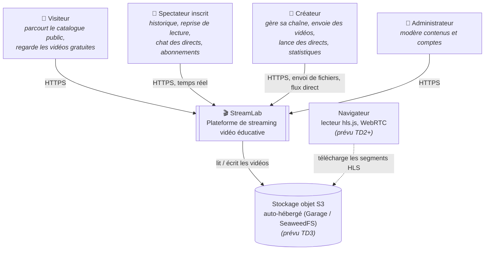

# 1. Contexte (C4 niveau 1)

> **Question :** qui utilise StreamLab, et avec quels systèmes externes interagit-il ?
> À ce niveau, StreamLab est **une seule boîte** : on ne regarde pas encore à l'intérieur.

## Diagramme

## Acteurs

| Acteur | Besoin principal | Disponible depuis |
| --- | --- | --- |
| Visiteur | Découvrir et regarder sans compte | TD2 (catalogue), TD4 (lecture) |
| Spectateur inscrit | Retrouver son historique, interagir | TD5 (comptes) |
| Créateur | Publier et mesurer son audience | TD3 (envoi), TD4 (stats) |
| Administrateur | Garder la plateforme saine | TD5 + modules de groupes |

## Systèmes externes

Tout est **auto-hébergé et open source** (exigence non fonctionnelle) : il n'y a aucun service cloud payant. Le seul système « externe » de la cible est le stockage objet compatible S3, qui tourne lui aussi dans Docker.

## État au TD1

Aucun acteur humain n'utilise encore le système : le TD1 construit le **socle technique**. Le seul « utilisateur » est le développeur, qui déclenche un événement de test (`POST /dev/ping`) et observe sa traversée de Kafka.
