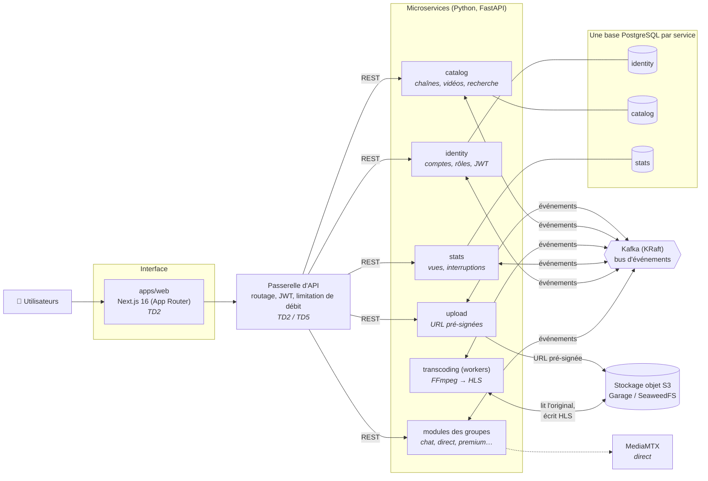
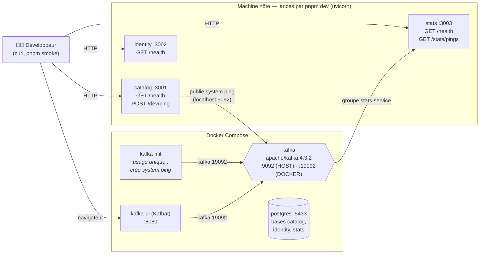

# 2. Conteneurs (C4 niveau 2)

> **Question :** quelles applications et quelles bases composent StreamLab, et comment communiquent-elles ?
> Un « conteneur », au sens C4, est une unité qui s'exécute ou qui stocke des données : application web, service, base, broker. Ce n'est pas forcément un conteneur Docker.

## 2.1 Architecture cible

Règles qui se lisent sur ce schéma :
- **l'interface ne parle qu'à la passerelle** ;
- **entre services, on communique par événements Kafka** (asynchrone). Le REST est réservé à l'entrée par la passerelle ;
- **chaque service a sa base** : aucune flèche ne relie un service à la base d'un autre.

## 2.2 État au TD1 (ce qui existe réellement)

| Conteneur | Technologie | Rôle au TD1 | Port |
| --- | --- | --- | --- |
| `services/catalog` | FastAPI + uvicorn | Publie `system.ping` | 3001 |
| `services/identity` | FastAPI + uvicorn | Squelette (`/health`) | 3002 |
| `services/stats` | FastAPI + uvicorn + thread consommateur | Consomme `system.ping`, compte les pings | 3003 |
| `kafka` | Apache Kafka 4.3.2, KRaft, un nœud | Broker et controller | 9092 |
| `kafka-init` | même image | Crée les topics puis s'arrête | — |
| `kafka-ui` | Kafbat UI v1.5.1 | Observer topics, messages, groupes | 8080 |
| `postgres` | PostgreSQL 16 | Bases créées, pas encore utilisées | 5433 |

Les bibliothèques partagées ne sont pas des conteneurs : `packages/contracts` (contrats d'événements) et `packages/kafka` (publisher/consumer) sont **importées** par les services.

### Pourquoi les services ne sont-ils pas dans Docker ?
Au TD1, les lancer sur l'hôte avec uvicorn donne un rechargement instantané, des journaux lisibles et un débogage facile, sans construire d'image : c'est aussi plus économe en données. Ils seront conteneurisés au TD6 (déploiement). Ils utilisent donc le listener **HOST** de Kafka (`localhost:9092`) ; voir [infrastructure locale](04-infrastructure-locale.md).
