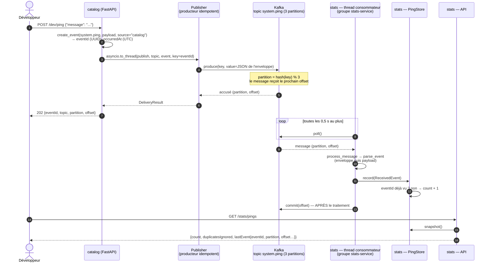
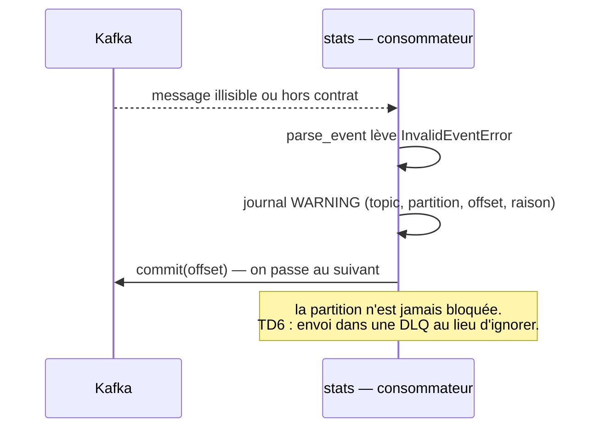
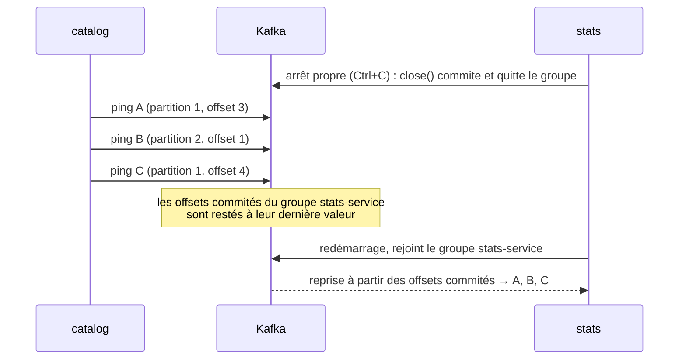

# 3. Flux du ping (TD1)

> **Question :** que se passe-t-il exactement entre `POST /dev/ping` et `GET /stats/pings` ?
> Ce flux minimal contient déjà tous les mécanismes des TD suivants : enveloppe, clé, partition, groupe, offset, idempotence.

## 3.1 Cas nominal



Points clés :
1. **202 Accepted** et non 200 : l'événement est dans Kafka, mais son traitement par les consommateurs viendra plus tard. Le producteur ne sait pas qui le lira.
2. **La clé choisit la partition.** Par défaut, la clé vaut l'`eventId`, donc les pings se répartissent sur les 3 partitions. Avec `{"key": "abc"}`, tous les pings de clé `abc` vont dans la même partition, donc **dans l'ordre**.
3. **`publish` est bloquant** (il attend l'accusé de Kafka) : il s'exécute dans un thread pour ne pas geler le serveur async.
4. **Le consommateur tourne dans son propre thread**, car `poll()` est bloquant. Le `PingStore` est protégé par un verrou, puisque ce thread écrit pendant que l'API lit.

## 3.2 Message invalide (« poison pill »)



Si le consommateur plantait sur ce message, il le relirait indéfiniment au redémarrage, et la partition serait **bloquée pour toujours**.

## 3.3 Reprise après arrêt de stats



Vérifié lors du TD1 : 3 pings publiés pendant l'arrêt, puis 3 pings reçus au redémarrage, en environ 2 s.

**Au moins une fois → idempotence.** Si stats plante *entre* le traitement et le commit, le message est relu. Le `PingStore` reconnaît l'`eventId` et l'ignore (`duplicatesIgnored`).

**Arrêt forcé = membre fantôme.** Un processus tué brutalement ne quitte pas le groupe : le coordinateur attend l'expiration de sa session (`session.timeout.ms`, 45 s par défaut) avant de réattribuer ses partitions. Observé au TD1 : environ 20 s de démarrage après un arrêt forcé, contre environ 2 s après un arrêt propre.

## 3.4 Le refaire soi-même

```powershell
# une fois l'infra et les services démarrés
curl.exe -X POST localhost:3001/dev/ping -H "content-type: application/json" -d '{\"key\":\"abc\"}'
curl.exe localhost:3003/stats/pings
pnpm smoke
```

Puis dans Kafbat UI (http://localhost:8080) : *Topics → system.ping → Messages* pour voir les enveloppes, et *Consumers → stats-service* pour voir les offsets et le *lag*.
