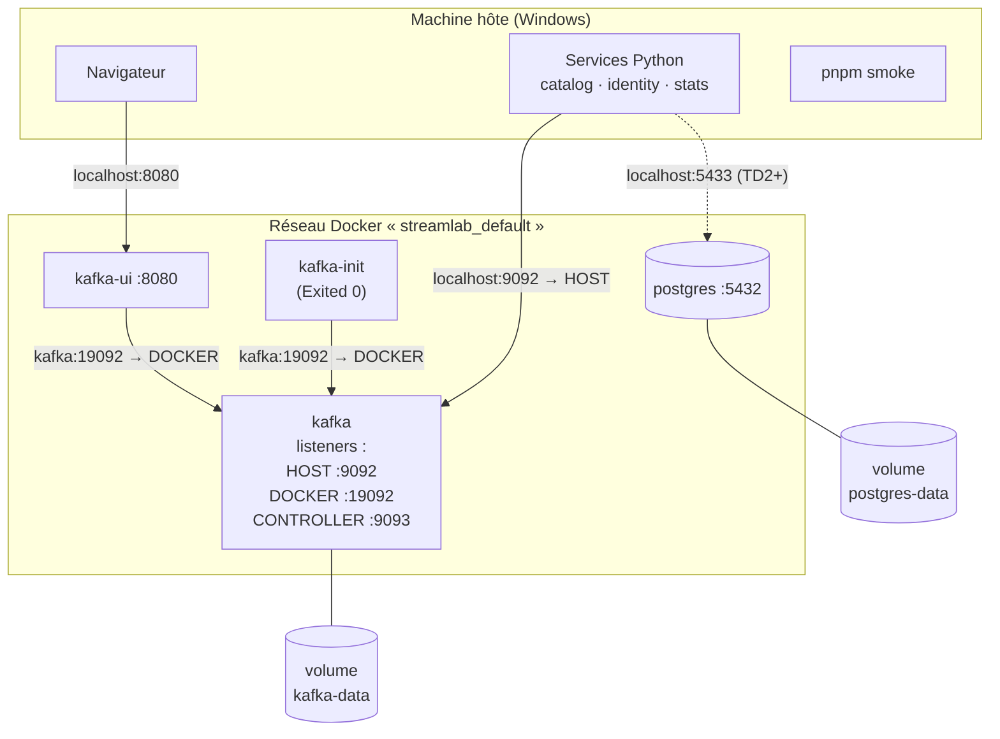

# 4. Infrastructure locale

> **Question :** comment l'infrastructure Docker est-elle configurée, et pourquoi ?
> Fichier de référence : [`docker-compose.yml`](../../docker-compose.yml). Ports : [`.env.example`](../../.env.example).

## 4.1 Topologie

## 4.2 Kafka en mode KRaft

- **KRaft** : depuis Kafka 4, il n'y a plus de ZooKeeper. Les métadonnées (topics, partitions, leaders) sont gérées par Kafka lui-même grâce au protocole de consensus Raft.
- **Un seul nœud** avec `KAFKA_PROCESS_ROLES=broker,controller` : il stocke les messages (broker) **et** gère les métadonnées (controller). En production, on séparerait les rôles et on aurait au moins 3 nœuds.
- **Facteurs de réplication à 1** : il n'y a qu'un nœud, donc aucune copie possible.
- `KAFKA_AUTO_CREATE_TOPICS_ENABLE=false` : un topic mal orthographié provoque une **erreur**, au lieu de créer un nouveau topic en silence.
- `KAFKA_GROUP_INITIAL_REBALANCE_DELAY_MS=0` : un consommateur reçoit ses partitions sans le délai de 3 s par défaut.

### Les listeners (le point le plus important)

Un client Kafka se connecte d'abord à une adresse d'amorçage. Le broker lui renvoie ensuite **l'adresse à utiliser pour la suite** : c'est l'*advertised listener*. Or le broker est joignable sous deux noms selon l'endroit d'où l'on vient :

| Listener | Écoute | Annoncé comme | Utilisé par | Pourquoi |
| --- | --- | --- | --- | --- |
| `HOST` | `:9092` | `localhost:${KAFKA_PORT}` | services Python sur l'hôte | depuis l'hôte, le port publié est sur `localhost` |
| `DOCKER` | `:19092` | `kafka:19092` | Kafbat UI, kafka-init | dans un conteneur, `localhost` désigne **le conteneur lui-même** ; le nom DNS `kafka` désigne le broker |
| `CONTROLLER` | `:9093` | (jamais annoncé) | consensus KRaft | trafic interne |

**Symptôme typique d'une erreur de listener** : la connexion initiale réussit, puis le client échoue sur `kafka:19092` (nom inconnu depuis l'hôte) ou sur `localhost:9092` (refusé depuis un conteneur).

Le *healthcheck* passe par `kafka:19092` : il reste valable même si l'on change `KAFKA_PORT`.

## 4.3 kafka-init : création des topics

Le conteneur à usage unique réutilise l'image Kafka (aucun téléchargement en plus) :
1. il attend `kafka: condition: service_healthy` ;
2. il exécute [`infra/kafka/create-topics.sh`](../../infra/kafka/create-topics.sh), avec `kafka-topics.sh --create --if-not-exists`, donc **idempotent** ;
3. il s'arrête (`Exited (0)` est son état normal).

Ajouter un topic : ADR, puis une ligne `create_topic <nom> <partitions>` dans le script, puis la constante dans `packages/contracts`, puis `docker compose up kafka-init`.

## 4.4 PostgreSQL

- Image `postgres:16-alpine`, déjà présente sur les machines du cours.
- Port hôte **5433** par défaut (5432 est souvent pris par une installation locale).
- [`infra/postgres/init/01-create-service-databases.sh`](../../infra/postgres/init/01-create-service-databases.sh) crée **une base et un utilisateur par service**. Il ne s'exécute **qu'au premier démarrage** (volume vide) ; pour le rejouer : `pnpm infra:reset`. Détails : [données](06-donnees.md).

## 4.5 Budget mémoire

| Conteneur | Limite | Mesuré au repos (TD1) |
| --- | --- | --- |
| kafka (`KAFKA_HEAP_OPTS=-Xmx512m`) | 1 Go | ≈ 400 Mo |
| kafka-ui (`JAVA_OPTS=-Xmx256m`) | 512 Mo | ≈ 290 Mo |
| postgres | 256 Mo | ≈ 60 Mo |
| **Total** | | **≈ 750 Mo** |

Sur une machine de 8 Go, limiter WSL 2 à 4-6 Go via `.wslconfig` (voir le README).

## 4.6 Images et économie de données

| Image | Taille | Remarque |
| --- | --- | --- |
| `apache/kafka:4.3.2` | ≈ 240 Mo compressé | sert à `kafka` et à `kafka-init` |
| `ghcr.io/kafbat/kafka-ui:v1.5.1` | ≈ 620 Mo sur disque | version épinglée |
| `postgres:16-alpine` | ≈ 395 Mo sur disque | réutilisée |

Jamais de tag `latest`, jamais de `docker compose pull`. Pour partager les images sans Internet : `docker save` / `docker load` (voir le README).
