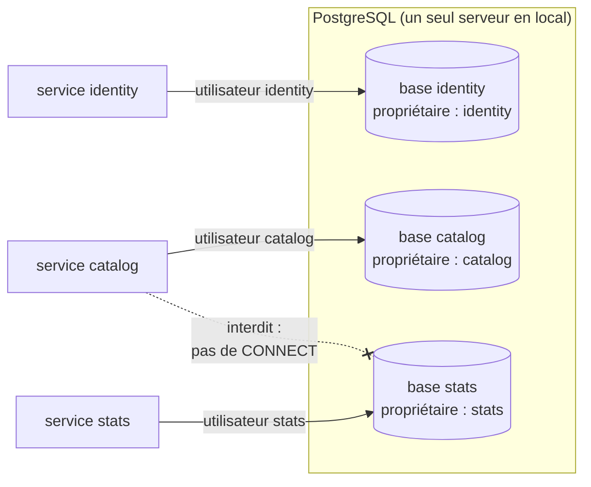

# 6. Données : une base par service

> **Question :** qui possède quelle donnée, et comment un service obtient-il une donnée qui ne lui appartient pas ?

## 6.1 Propriété des bases



| Base | Utilisateur | Variable du mot de passe | Utilisée depuis |
| --- | --- | --- | --- |
| `catalog` | `catalog` | `CATALOG_DB_PASSWORD` | TD2 |
| `identity` | `identity` | `IDENTITY_DB_PASSWORD` | TD5 |
| `stats` | `stats` | `STATS_DB_PASSWORD` | TD4 |

Au TD1, les bases sont créées mais **aucun service ne s'y connecte encore**. Le compteur de stats est en mémoire.

## 6.2 Comment l'isolation est garantie

Le script [`01-create-service-databases.sh`](../../infra/postgres/init/01-create-service-databases.sh) exécute, pour chaque service :

```sql
CREATE ROLE catalog LOGIN PASSWORD '...';    -- un utilisateur par service
CREATE DATABASE catalog OWNER catalog;       -- la base lui appartient
REVOKE ALL ON DATABASE catalog FROM PUBLIC;  -- personne d'autre ne peut s'y connecter
```

Par défaut, PostgreSQL accorde `CONNECT` sur toute base au pseudo-rôle `PUBLIC` (tout le monde). Le `REVOKE` retire ce droit. Le propriétaire garde ses droits implicites.

Vérification faite au TD1 :

```text
catalog -> base catalog : OK
catalog -> base stats   : DETAIL:  User does not have CONNECT privilege.
```

## 6.3 Pourquoi une base par service ?

- **Autonomie** : un service peut changer son schéma sans coordonner les autres équipes ou groupes.
- **Couplage explicite** : la seule façon d'obtenir une donnée d'un autre service est son **API** ou ses **événements**. Ce sont des contrats versionnés, contrairement à des tables qui changent sans prévenir.
- **Pannes isolées** : une requête lente dans `stats` ne bloque pas `catalog`.

En local, les trois bases sont sur **un seul serveur PostgreSQL** pour économiser la mémoire. L'isolation est **logique** (droits), pas physique. En production, on pourrait séparer les serveurs sans rien changer au code.

## 6.4 Obtenir une donnée qui ne nous appartient pas

| Besoin | Mauvaise solution | Bonne solution |
| --- | --- | --- |
| stats veut le titre d'une vidéo | `SELECT` dans la base catalog | consommer `video.published` et garder **sa propre copie** des champs utiles (projection locale) |
| la passerelle veut vérifier un utilisateur | lire la table `users` | vérifier le JWT émis par identity |
| catalog veut savoir qu'un transcodage est fini | interroger la base de transcoding | consommer `video.transcoded` |

Conséquence à assumer : les copies locales sont **cohérentes à terme** (*eventually consistent*) ; elles peuvent avoir un léger retard.
